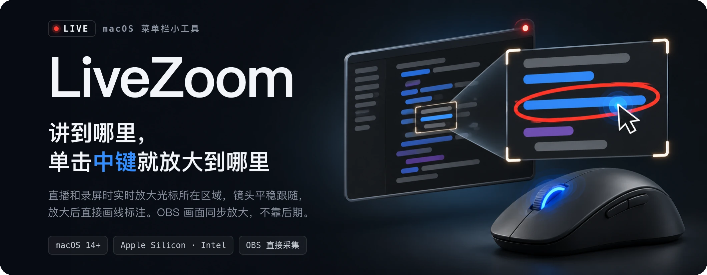
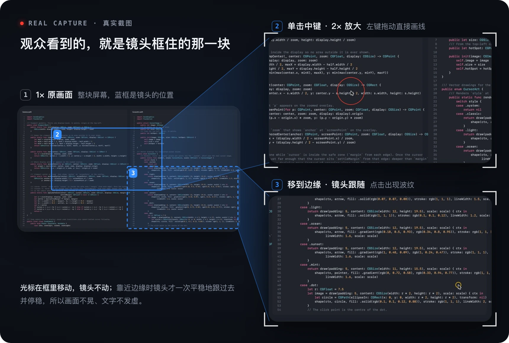
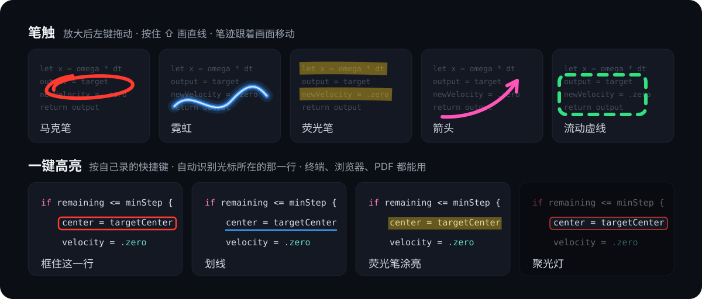
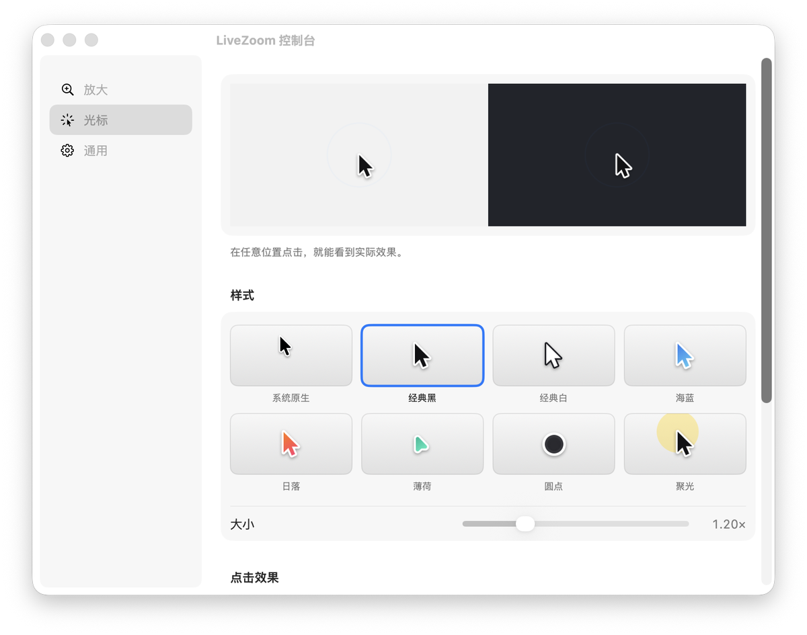
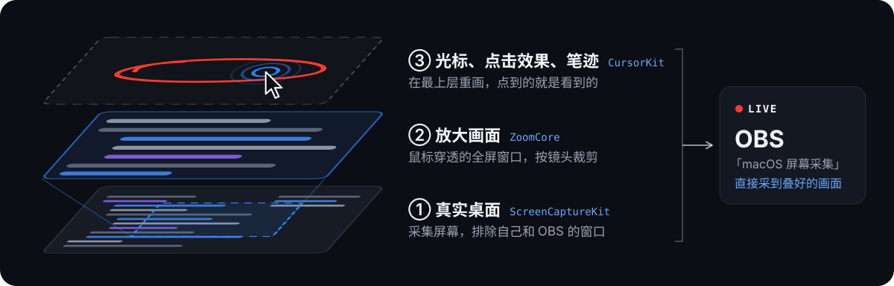

<p align="center">
  
</p>

<p align="center">
  <a href="https://github.com/NanmiCoder/live-screen-studio/releases/latest"></a>
  
</p>

<p align="center">
  <a href="#下载安装"><b>下载安装</b></a> &nbsp;·&nbsp;
  <a href="#怎么用">怎么用</a> &nbsp;·&nbsp;
  <a href="#画线和一键高亮">画线和高亮</a> &nbsp;·&nbsp;
  <a href="#工作原理">工作原理</a> &nbsp;·&nbsp;
  <a href="#从源码编译">从源码编译</a>
</p>

讲代码、演示软件时，观众常常看不清你指的是哪一行。LiveZoom 常驻在菜单栏：**单击鼠标中键，光标所在的区域就平滑放大**；移动鼠标，镜头平稳地跟着走；放大后还能直接画线、一键高亮。

放大是实时的，你的屏幕和 OBS 画面一起放大，不需要 Screen Studio 这类后期软件。

<p align="center">
  
</p>

## 怎么用

| 操作 | 效果 |
| --- | --- |
| 单击中键 | 以光标为中心平滑放大（默认 2×），再按一次缩回 |
| 按住中键滚动滚轮 | 调整这次放大的倍数，1.25× 到 4× |
| 放大后移动鼠标 | 光标在画面中间时镜头不动，靠近边缘才平稳跟过去，不晕 |
| 放大后左键拖动 | 画线标注，按住 ⇧ 画直线 |
| 放大后按高亮快捷键 | 框住、划线、涂亮光标所在的那一行，或打开聚光灯 |
| 右键 / Esc | 撤销一笔或一个高亮 / 清除全部；缩回时自动清除 |
| ⌘ + 左键拖动 | 放大状态下正常拖拽、选文字 |
| ⌥ + 中键 | 原来的中键点击 |

放大时画面是活的，可以照常点击、打字、滚动。光标会留在这块屏幕内，不会滑到别的屏或碰出程序坞，只有单击中键才缩回。

## 画线和一键高亮

<p align="center">
  
</p>

- **笔触**：放大后左键拖动就能画，笔迹跟着画面移动。样式、颜色和粗细在控制台里选。
- **一键高亮**：在控制台录好快捷键，放大后按下，LiveZoom 会自动找到光标所在的那一行文字再加标注。聚光灯会压暗这一行以外的画面。

## 光标与控制台

<p align="center">
  
</p>

- 8 种光标样式，大小可调；点击时出现波纹或光圈，颜色可选。
- 可以开启移动平滑、静止后自动隐藏。
- 默认平时也使用自定义光标，可以在控制台关掉，关掉后只在放大时使用。
- 控制台分「放大 / 光标 / 通用」三页：默认倍数、触发键（中键或侧键）、跟随速度、画笔样式 / 颜色 / 粗细、高亮快捷键录制、权限状态、登录时启动。

## 工作原理

<p align="center">
  
</p>

1. **采集**：用 ScreenCaptureKit 采集光标所在的显示器，排除 LiveZoom 自己和 OBS 的窗口。
2. **放大**：在这块显示器上盖一个鼠标穿透的全屏窗口，按镜头位置裁剪采集画面。OBS 的「macOS 屏幕采集」会直接采到这个窗口，不用改 OBS 设置。
3. **重画光标**：隐藏系统光标，在最上层重画光标、点击效果和笔迹，位置和放大后的画面一一对应，所以放大时点到的就是看到的。
4. **跟随**：镜头以光标为不动点缓动放大；光标在安全区内时不跟随，越界后一次平稳挪到位并精确停住，避免文字发虚。
5. **高亮**：按高亮快捷键时，用系统的 Vision 文字识别读取光标附近的那一条画面，找出光标所在那一行的范围，所以终端、浏览器、PDF 里都能用。

## 下载安装

在 [Releases](https://github.com/NanmiCoder/live-screen-studio/releases) 下载对应芯片的版本，解压后拖进「应用程序」：

| 芯片 | 文件 |
| --- | --- |
| Apple Silicon（M 系列） | `LiveZoom-<版本>-macos-apple-silicon.zip` |
| Intel | `LiveZoom-<版本>-macos-intel.zip` |

第一次运行需要两项授权：

- **辅助功能**：识别中键、点击和画笔手势。
- **屏幕录制**：采集要放大的画面。授权后退出并重新打开 LiveZoom。

发布包使用 Developer ID 签名并经过公证，可以直接打开。

> [!NOTE]
> v0.2.0 是 ad-hoc 签名，没有公证。第一次打开如果被系统拦截，在终端执行 `xattr -dr com.apple.quarantine /Applications/LiveZoom.app`，或在「系统设置 → 隐私与安全性」里点「仍要打开」。ad-hoc 签名下，每次升级后都要重新授权辅助功能和屏幕录制。

## 直播小贴士

- OBS 输出帧率建议设成 60fps，放大和光标移动会更顺。
- 罗技鼠标请在 Logi Options+ 里保持「中键 = 中键单击」。侧键被映射成系统手势时，LiveZoom 收不到侧键。
- 只有一块屏进直播时，放大其他屏不会影响直播画面。

## 已知限制

- 放大画面经过一次屏幕采集，比真实画面晚 1～2 帧。
- 高亮快捷键靠识别画面上的文字，按下后约 0.2 秒出现；字太小、对比度太低或光标不在文字上时，不会有反应。
- 全屏播放视频时，播放器会隐藏系统光标，但自绘光标不会跟着消失；可以打开「静止后自动隐藏」。
- 自定义样式只替换普通箭头（「圆点」也替换手型），文本光标等保持系统原样；改过系统指针大小或颜色时显示系统原样光标。
- 放大期间光标出不了当前屏幕，也碰不到程序坞；要去别的屏幕或用程序坞，先单击中键缩回。如果系统接管了光标（例如固定显示的程序坞、⌘⇧4 截图），会自动缩回。

## 从源码编译

需要 macOS 14 以上和 Xcode 16 以上（Swift 6 工具链）。

```bash
git clone git@github.com:NanmiCoder/live-screen-studio.git
cd live-screen-studio
scripts/build-app.sh      # 编译并签名 build/LiveZoom.app
open build/LiveZoom.app
```

`build-app.sh` 默认用本机的 Apple Development 证书签名，签名身份固定，重新编译后授权不会丢。

- 用 `CODESIGN_IDENTITY` 指定证书。
- 用 `ARCH=arm64` 或 `ARCH=x86_64` 指定架构。
- 找不到证书时会退回 ad-hoc 签名，这时每次编译后都要重新授权。

## 开发

```bash
swift test                                              # 镜头算法与光标绘制的单测
swift build
.build/debug/LiveZoom --demo <显示器 ID> <输出目录>      # 用虚拟光标在一块屏上跑完整流程并截图
.build/debug/LiveZoom --cursor-diagnose <输出目录>       # 检查屏幕上是否只有一个光标
```

| 目录 | 内容 |
| --- | --- |
| `Sources/ZoomCore` | 镜头算法：缩放、跟随、限速 |
| `Sources/CursorKit` | 光标样式、平滑与点击效果 |
| `Sources/LiveZoom` | App 本体：屏幕采集、叠加窗口、事件监听、控制台 |
