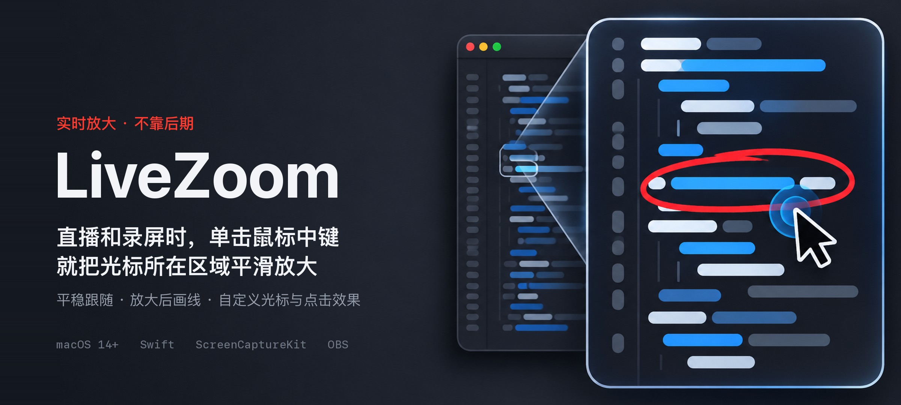
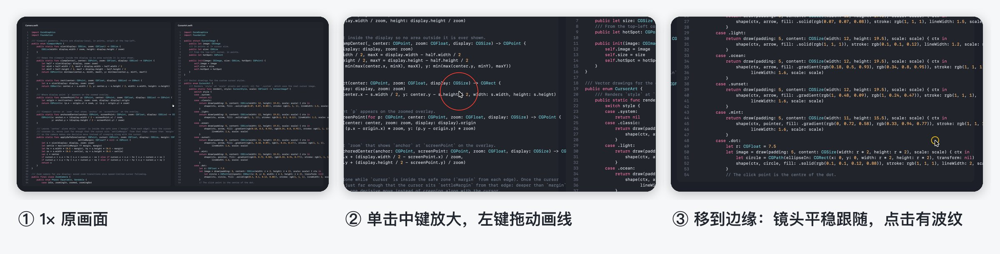

<p align="center">
  
</p>

<p align="center">
  <b>macOS 菜单栏小工具</b>：讲到哪里，单击中键就放大到哪里；放大后镜头平稳地跟着鼠标走，还能直接画线标注。<br>
  效果是实时的，你的屏幕和 OBS 画面一起放大，不需要 Screen Studio 这类后期软件。
</p>

<p align="center">
  
</p>

## 能做什么

| 操作 | 效果 |
| --- | --- |
| 单击鼠标中键 | 以光标为中心平滑放大（默认 2×），再按一次缩回 |
| 按住中键滚动滚轮 | 调整这次放大的倍数（1.25× 到 4×） |
| 放大后移动鼠标 | 光标在画面中间时镜头不动，靠近边缘才平稳跟过去，不晕 |
| 放大后左键拖动 | 画线标注，按住 ⇧ 画直线；笔迹跟着画面移动 |
| 右键 / Esc | 撤销一笔 / 清除全部笔迹；缩回时自动清除 |
| ⌘ + 左键拖动 | 放大状态下正常拖拽、选文字 |
| ⌥ + 中键 | 原来的中键点击 |

放大时画面是活的：可以照常点击、打字、滚动。

## 自定义光标与控制台

<p align="center">
  
</p>

- 8 种光标样式，大小可调；点击时出现波纹或光圈，颜色可选。
- 可以开启移动平滑、静止后自动隐藏。
- 默认平时也使用自定义光标，可以在控制台关掉，关掉后只在放大时使用。
- 控制台分「放大 / 光标 / 通用」三页：默认倍数、触发键（中键或侧键）、跟随速度、画笔开关、权限状态、登录时启动。

## 工作原理

1. 用 ScreenCaptureKit 采集光标所在的显示器，排除 LiveZoom 自己和 OBS 的窗口。
2. 在这块显示器上盖一个鼠标穿透的全屏窗口，按镜头位置裁剪采集画面来实现缩放。OBS 的「macOS 屏幕采集」会直接采到这个窗口，不用改 OBS 设置。
3. 隐藏系统光标，在最上层重画光标、点击效果和笔迹，位置和放大后的画面一一对应，所以放大时点到的就是看到的。
4. 镜头以光标为不动点缓动放大；光标在安全区内时不跟随，越界后一次平稳挪到位并精确停住，避免文字发虚。

## 安装

需要 macOS 14 以上和 Xcode 16 以上（Swift 6 工具链）。

```bash
git clone git@github.com:NanmiCoder/live-screen-studio.git
cd live-screen-studio
scripts/build-app.sh      # 编译并签名 build/LiveZoom.app
open build/LiveZoom.app
```

第一次运行需要两项授权：

- **辅助功能**：识别中键、点击和画笔手势。
- **屏幕录制**：采集要放大的画面。授权后退出并重新打开 LiveZoom。

`build-app.sh` 默认用本机的 Apple Development 证书签名，签名身份固定，重新编译后授权不会丢。可以用 `CODESIGN_IDENTITY` 指定证书；找不到证书时会退回 ad-hoc 签名，这时每次编译后都要重新授权。

## 直播小贴士

- OBS 输出帧率建议设成 60fps，放大和光标移动会更顺。
- 罗技鼠标请在 Logi Options+ 里保持「中键 = 中键单击」。侧键被映射成系统手势时，LiveZoom 收不到侧键。
- 只有一块屏进直播时，放大其他屏不会影响直播画面。

## 已知限制

- 放大画面经过一次屏幕采集，比真实画面晚 1～2 帧。
- 全屏播放视频时，播放器会隐藏系统光标，但自绘光标不会跟着消失；可以打开「静止后自动隐藏」。
- 自定义样式只替换普通箭头（「圆点」也替换手型），文本光标等保持系统原样；改过系统指针大小或颜色时显示系统原样光标。
- 鼠标在程序坞上时光标由系统接管，这时显示系统光标；放大中碰到程序坞会自动缩回。

## 开发

```bash
swift test                                              # 镜头算法与光标绘制的单测
swift build
.build/debug/LiveZoom --demo <显示器 ID> <输出目录>      # 用虚拟光标在一块屏上跑完整流程并截图
.build/debug/LiveZoom --cursor-diagnose <输出目录>       # 检查屏幕上是否只有一个光标
```

代码结构：

- `Sources/ZoomCore`：镜头算法（缩放、跟随、限速）
- `Sources/CursorKit`：光标样式、平滑与点击效果
- `Sources/LiveZoom`：App 本体（屏幕采集、叠加窗口、事件监听、控制台）
