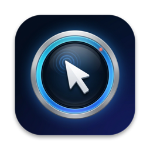
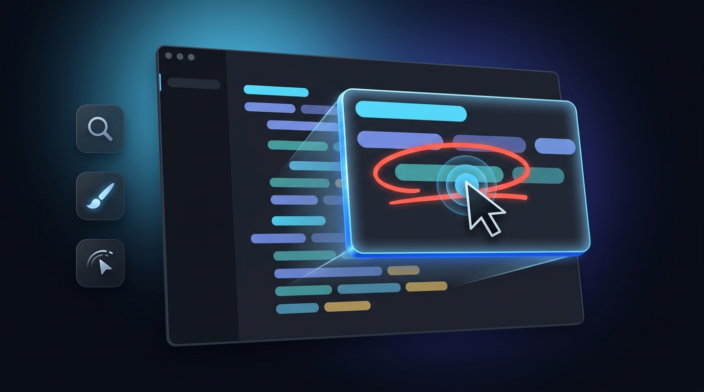
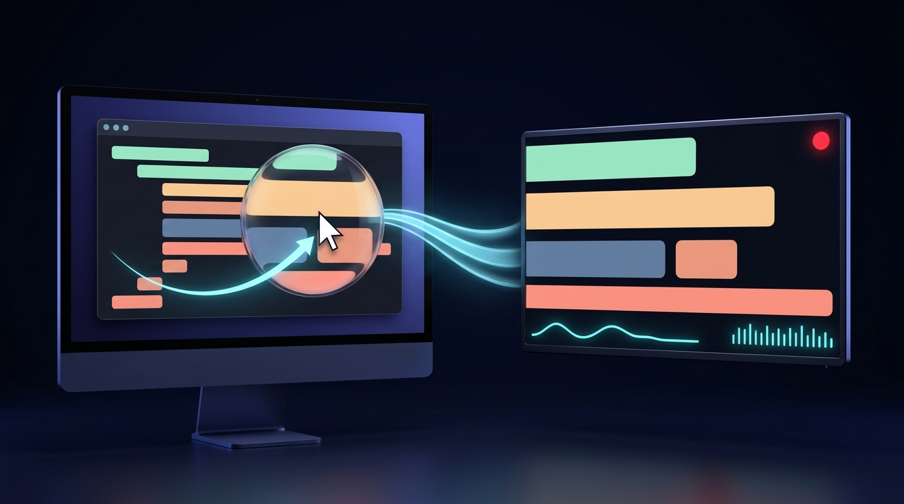
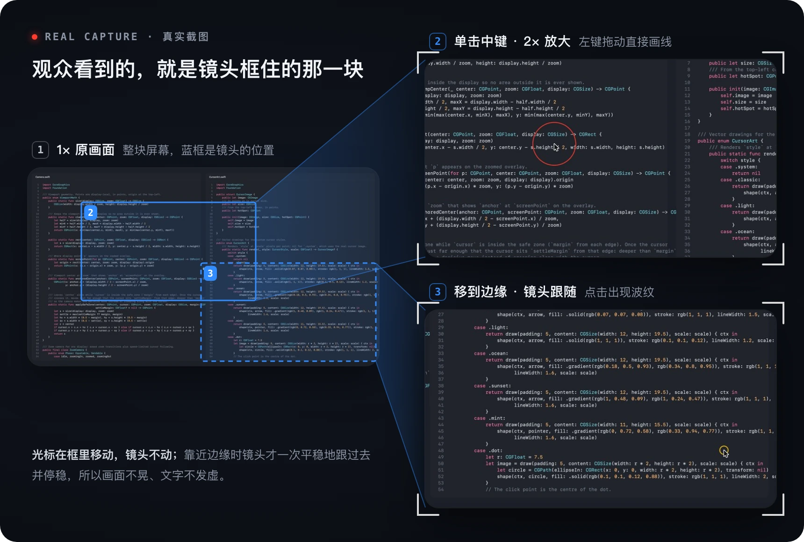
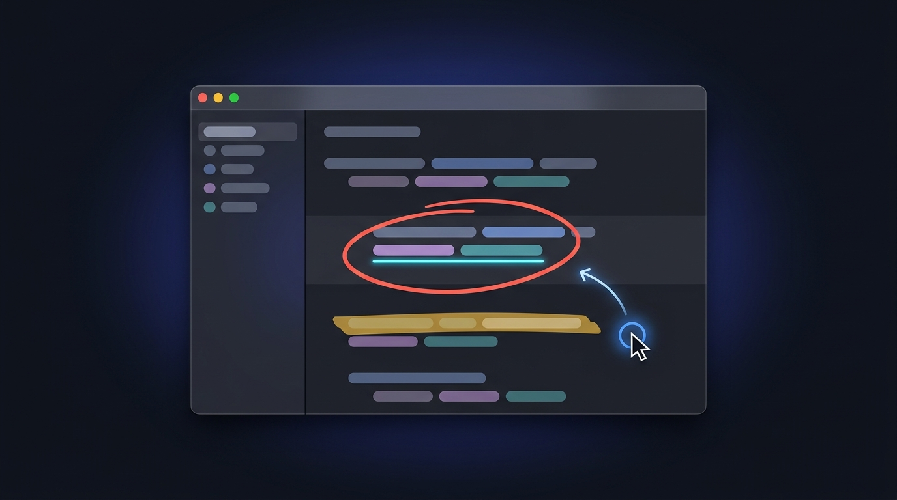
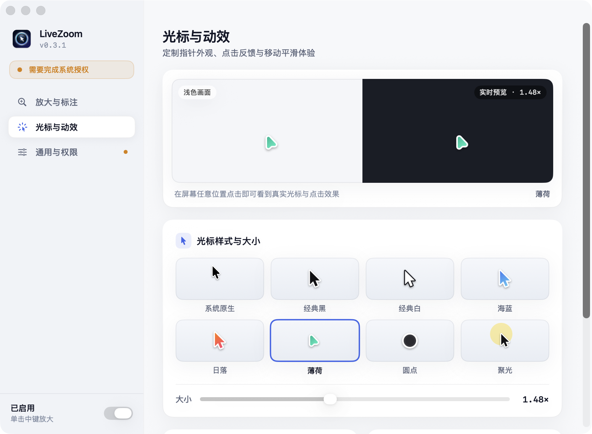
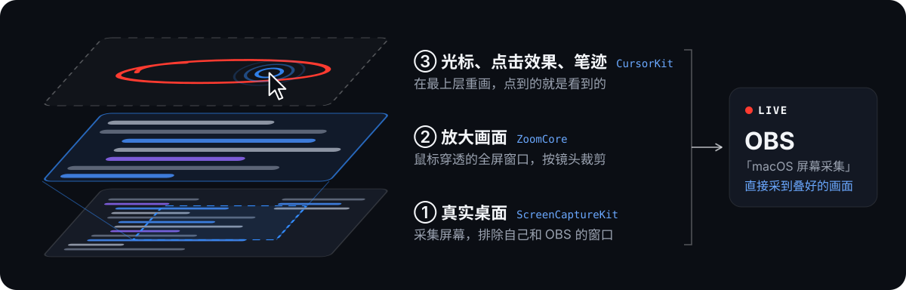

<div align="center">
  

  <h1>LiveZoom</h1>

  <p>
    <strong>macOS 直播与录屏实时放大工具</strong><br />
    讲到哪里，单击鼠标中键就把光标区域平滑放大；镜头平稳跟随、随时画线高亮，画面与 OBS 实时同步，无需后期剪辑。
  </p>

  <p>
    <a href="https://github.com/NanmiCoder/live-screen-studio/releases/latest">
      
    </a>
    
    
    
    
  </p>

  <p>
    <a href="https://github.com/NanmiCoder/live-screen-studio/releases/latest"><strong>下载安装包 (.dmg)</strong></a>
    &nbsp;·&nbsp;
    <a href="#核心特性">核心特性</a>
    &nbsp;·&nbsp;
    <a href="#快捷键与操作">快捷键与操作</a>
    &nbsp;·&nbsp;
    <a href="#安装与授权">安装与授权</a>
    &nbsp;·&nbsp;
    <a href="#工作原理">工作原理</a>
    &nbsp;·&nbsp;
    <a href="#从源码编译">从源码编译</a>
  </p>

  <br />

  
</div>

---

## 核心特性

### 1. 实时放大，所见即所播

<p align="center">
  
</p>

- **零后期剪辑**：所有缩放、镜头跟随、光标与标注都是**实时渲染**，你的屏幕和 OBS「macOS 屏幕采集」画面同步放大，不用再等 Screen Studio 导出。
- **不晕的镜头跟随**：放大后光标在安全区内自由移动时镜头保持静止；越界后一次平稳挪到位并按整像素对齐停住，消除文字亚像素闪烁。
- **放大时画面依然是活的**：可以照常点击按钮、输入代码、滚动页面；光标保持在当前屏幕内，不会滑到副屏或误触程序坞。

<p align="center">
  
</p>

---

### 2. 放大即画板 & 智能识别文字高亮

<p align="center">
  
</p>

- **5 种实时笔触**：放大时左键拖动即可直接画线（按住 `⇧` 画直线），笔迹随镜头平滑移动，缩回时自动淡出。支持**马克笔、霓虹、荧光笔、箭头、流动虚线**。
- **Vision 智能识别文字行**：按下自己录制的快捷键，自动识别光标所在的那一行文字并添加**框选、下划线、荧光笔涂亮或聚光灯（压暗其余画面）**，终端、IDE、浏览器、PDF 通用。

---

### 3. 自定义光标与控制台

<p align="center">
  
</p>

- **8 种精致光标样式**：大小自由调节，支持点击波纹 / 光圈与自定义颜色。
- **丝滑体验开关**：支持光标移动平滑、静止后自动隐藏；可按需开启「平时也使用自定义光标」，关闭后仅在放大时启用。
- **简洁三页控制台**：「放大与标注 / 光标与动效 / 通用与权限」三页覆盖默认倍数、触发键（中键或鼠标侧键）、跟随速度、画笔样式、画线撤销快捷键（默认 `⌘Z` 可自定义）、高亮快捷键录制、系统权限状态与登录自启。

---

## 快捷键与操作

| 操作 | 效果 |
| --- | --- |
| **单击鼠标中键**（可改侧键） | 以光标为中心平滑放大（默认 `2×`），再按一次缩回 |
| **按住中键 + 滚动滚轮** | 实时调整本次放大倍数（`1.25×` ～ `4×`） |
| **放大后左键拖动** | 直接画线标注；按住 `⇧` 画直线 |
| **放大后按高亮快捷键** | 智能识别光标所在文字行并高亮 / 开启聚光灯 |
| **`⌘Z`（可自定义） / 右键** | 撤销上一笔或上一个高亮 |
| **`Esc`** | 清除全部标注 |
| **`⌘` + 左键拖动** | 放大状态下正常拖拽、框选文字 |
| **`⌥` + 中键** | 透传系统原本的中键点击 |

---

## 安装与授权

### 下载安装包（推荐）

前往 [Releases](https://github.com/NanmiCoder/live-screen-studio/releases/latest) 下载对应芯片的 `.dmg` 安装包，双击打开后将 **LiveZoom** 拖进右侧的 **Applications（应用程序）** 文件夹即可：

| 文件 | 适用机型 |
| --- | --- |
| `LiveZoom-<版本>-macos-apple-silicon.dmg` | Apple Silicon（M1 / M2 / M3 / M4 系列） |
| `LiveZoom-<版本>-macos-intel.dmg` | Intel 芯片 Mac |

- **防误删保护**：如果不小心直接从安装包或「下载」文件夹运行，LiveZoom 启动时会自动弹窗提示一键移入「应用程序」文件夹并重启，之后清理下载目录不会丢失。
- **签名与公证**：正式发布包均使用 Developer ID 签名并通过 Apple 公证（`.app` 与 `.dmg` 均已 staple），下载后可直接打开。

> [!NOTE]
> 历史版本 `v0.2.0` 为 ad-hoc 签名：首次打开如被拦截，可执行 `xattr -dr com.apple.quarantine /Applications/LiveZoom.app`，或在「系统设置 → 隐私与安全性」点击「仍要打开」。

### 首次运行授权

第一次运行需要授予两项 macOS 隐私权限（控制台「通用与权限」页可实时查看并一键跳转设置）：

1. **辅助功能**：用于识别中键/侧键触发、点击效果和画笔手势。
2. **屏幕录制**：用于采集需要放大的屏幕画面。**授权后请退出并重新打开 LiveZoom 使其生效。**

---

## 工作原理

<p align="center">
  
</p>

1. **采集**：使用 **ScreenCaptureKit** 高帧率采集光标所在显示器，自动排除 LiveZoom 自身及 OBS 窗口。
2. **放大**：在该显示器上叠加一层鼠标穿透的全屏窗口，按镜头视口实时裁剪缩放采集画面；OBS「macOS 屏幕采集」直接采集即可，无需任何 OBS 插件或改动。
3. **重画光标**：精准隐藏系统光标并在最上层重绘光标、点击波纹和标注笔迹，与放大后的坐标一一对应，点到的就是看到的。
4. **跟随**：镜头以光标为不动点缓动缩放，静止平移按输出整像素对齐，保证高分屏代码文字清晰不闪烁。
5. **高亮**：高亮快捷键借助系统 **Vision** OCR 识别光标附近的文本行范围并贴合渲染标注。

---

## 从源码编译

需要 **macOS 14+** 与 **Xcode 16+**（Swift 6 工具链）：

```bash
git clone git@github.com:NanmiCoder/live-screen-studio.git
cd live-screen-studio

# 方式 1：编译并直接安装到 /Applications/LiveZoom.app
scripts/build-app.sh --install
open /Applications/LiveZoom.app

# 方式 2：编译 build/LiveZoom.app 并打包为可拖拽安装的 .dmg
scripts/build-app.sh
scripts/build-dmg.sh
```

`build-app.sh` 默认使用本机的 Apple Development 证书签名，保持签名身份稳定，重新编译后辅助功能和屏幕录制授权不会失效；也可通过 `CODESIGN_IDENTITY` 指定证书、`ARCH=arm64` 或 `ARCH=x86_64` 指定架构（找不到证书时自动退回 ad-hoc 签名）。

---

## 直播小贴士与已知限制

- **OBS 帧率**：建议将 OBS 输出设为 `60fps`，放大与光标移动更顺滑。
- **罗技鼠标**：请在 Logi Options+ 中保持「中键 = 中键单击」；若侧键被映射为系统手势，LiveZoom 将无法捕获侧键。
- **多屏直播**：仅采集单屏进直播时，放大其他副屏不会影响主直播画面。

<details>
<summary>查看已知限制</summary>

- 放大画面经过一次屏幕采集，比真实画面延迟约 1～2 帧。
- 文字行高亮依赖画面 OCR 识别，按下快捷键后约 `0.2s` 出现；字号过小、对比度过低或光标不在文字上时不会触发。
- 全屏播放视频时，播放器会隐藏系统光标但自绘光标不会自动隐藏，可开启「静止后自动隐藏」或关闭「平时也使用自定义光标」。
- 自定义光标样式仅替换普通箭头（「圆点」同时替换手型），文本输入等光标保持系统原样；修改过系统指针大小或颜色时显示系统原样光标。
- 放大期间光标锁定在当前屏幕并避开程序坞边缘；需要切换屏幕或操作程序坞时先单击中键缩回。系统接管光标（例如固定程序坞、`⌘⇧4` 截图）时会自动缩回。

</details>

---

## 开发与代码结构

```bash
swift test                                              # 镜头算法与光标绘制单元测试
swift build
.build/debug/LiveZoom --demo <显示器 ID> <输出目录>      # 虚拟光标完整流程验证并截图
.build/debug/LiveZoom --cursor-diagnose <输出目录>       # 单光标与帧率诊断
```

| 目录 | 内容 |
| --- | --- |
| `Sources/ZoomCore` | 镜头缩放、安全区跟随、限速与整像素对齐算法 |
| `Sources/CursorKit` | 8 种光标渲染、运动平滑、点击动效与笔迹标注算法 |
| `Sources/LiveZoom` | App 本体（ScreenCaptureKit 采集、叠加窗口、事件监听、控制台、安装引导） |
